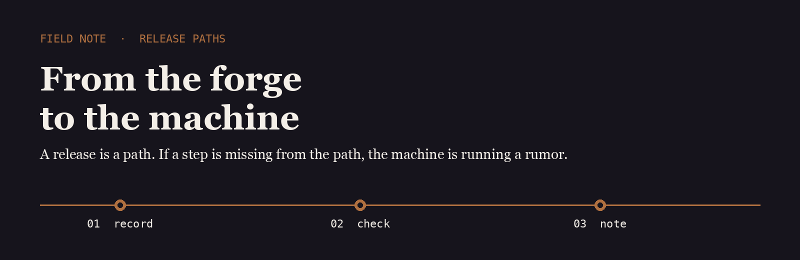
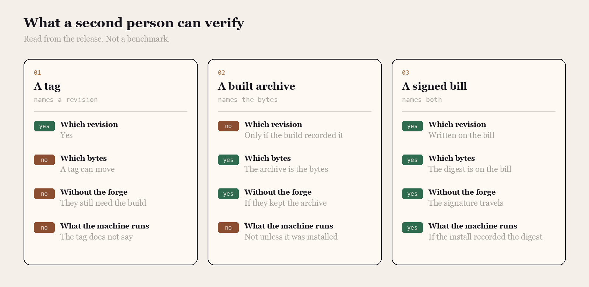

<p align="center">
  
</p>

# Forge Path

Forge Path is the name I use for the distance between a tagged revision and the machine that is actually running it.

## The question

A tag, a built archive, and a signed bill of materials are three points on that path. I asked which ones a second person can verify without the forge.

<p align="center">
  
</p>

|  | A tag | A built archive | A signed bill |
| --- | --- | --- | --- |
| Which revision | Yes | Only if the build recorded it | Written on the bill |
| Which bytes | A tag can move | The archive is the bytes | The digest is on the bill |
| Without the forge | They still need the build | If they kept the archive | The signature travels |
| What the machine runs | The tag does not say | Not unless it was installed | If the install recorded the digest |

## The line I keep

The line I want at the end of the path names the revision, the digest, and the machine. The signature is what lets the line travel.

```text
2026-03-26T01:12:55Z  app-2  rev 5aa91c7  sha256:44e1…9b  signed
```

Release tools already build, inventory, and sign. The note is the last step: the machine writes down the digest it is running.

- [goreleaser](https://github.com/goreleaser/goreleaser) builds the archive and can record the revision on it
- [syft](https://github.com/anchore/syft) writes the bill of what is inside
- [gitsign](https://github.com/sigstore/gitsign) signs the revision so the path starts from a commit you can check

I keep a fork of each on this account.

## What I pay attention to

- A release whose digest is on the machine, not only in the forge
- A bill a second person can read without rerunning the build
- A signature that travels with the revision
- Tools small enough to read in one sitting

## Working with me

Send a short problem statement, a way to see it happen, and what done looks like. I am independent, remote, and usually around during the Tokyo workday.
